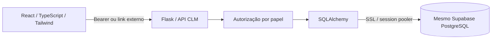
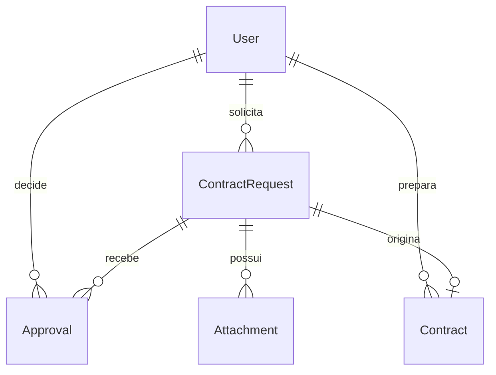

# Accordo — Gestão de Contratos (CLM)

Base funcional para o ciclo solicitação → aprovação → minuta → aceite → arquivo digital. Mantém o **mesmo PostgreSQL no Supabase**, configurado exclusivamente em `api_contratos_flask/.env`.

## A. Arquitetura e stack

- **Backend:** Python 3.10+, Flask, SQLAlchemy e psycopg2. Mantido o backend existente para aproveitar seus cadastros e evitar uma reescrita.
- **Frontend:** React 19, TypeScript em modo estrito, Tailwind CSS 4, Vite e Lucide.
- **Banco:** Supabase PostgreSQL, pooler de sessão, conexão SSL. As tabelas CLM têm RLS habilitado e acesso revogado para os papéis `anon` e `authenticated` da Data API; a autorização por usuário ocorre no Flask. As tabelas `clm_*` são aditivas; os dados legados são preservados.
- **Autenticação:** tokens Bearer assinados, válidos por oito horas; senha com hash scrypt. Papéis e departamentos são conferidos no servidor, a partir do banco.
- **Documentos:** binários no PostgreSQL nesta base, com limite de 5 MB por arquivo e hash SHA-256. Para volume maior, mover o conteúdo para um bucket privado do Supabase Storage, mantendo metadados e autorização na API.



```text
Gestao-de-contratos/
├── api_contratos_flask/
│   ├── app.py                 # API legada e registro do módulo CLM
│   ├── extensions.py          # Instância SQLAlchemy compartilhada
│   ├── clm/
│   │   ├── models.py          # User, ContractRequest, Approval, Contract, Attachment
│   │   ├── auth.py            # Autenticação e permissões
│   │   ├── schema.py          # RLS e bloqueio da Data API pública
│   │   └── routes.py          # Rotas, validações e transições do fluxo
│   ├── migrations/001_clm.sql # Esquema PostgreSQL revisável
│   ├── export_schema.py       # Regenera o SQL a partir dos modelos
│   ├── init_db.py             # Cria apenas tabelas ausentes
│   ├── test_app.py            # Regressão dos cadastros legados
│   ├── test_clm.py            # Testes do ciclo CLM e das permissões
│   └── .env                   # Credenciais locais, ignoradas pelo Git
├── frontend/
│   ├── src/
│   │   ├── main.tsx
│   │   ├── App.tsx            # Login e painel lista/Kanban
│   │   ├── api.ts             # Cliente HTTP e sessão
│   │   ├── types.ts           # Contratos TypeScript da API
│   │   ├── ui.tsx             # Componentes compartilhados
│   │   ├── tailwind.css
│   │   └── components/
│   │       ├── RequestForm.tsx
│   │       ├── RequestDetail.tsx
│   │       ├── SignaturePage.tsx
│   │       └── UserManagement.tsx
│   └── vite.config.js         # Proxy /api preserva o prefixo
├── backend/cliente.py         # Cliente legado de terminal
└── iniciar.ps1
```

O frontend anterior (`src/main.jsx` e `src/style.css`) foi preservado como referência; a entrada atual é `src/main.tsx`. O cliente de terminal antigo precisa enviar Bearer de um gestor para acessar os cadastros legados.

## B. Modelagem

O esquema executável está em **`api_contratos_flask/migrations/001_clm.sql`**. Os modelos ORM ficam em **`clm/models.py`**.

| Entidade | Tabela | Campos principais e restrições |
| --- | --- | --- |
| User | `clm_user` | nome, e-mail único, hash de senha, papel e departamento; somente aprovadores têm departamento obrigatório |
| ContractRequest | `clm_request` | requisitante, objeto, escopo, valor decimal, centro de custo, fornecedor, documento, e-mail, status e criação |
| Approval | `clm_approval` | pedido, aprovador, departamento, decisão, comentário e data; uma decisão por departamento/pedido |
| Contract | `clm_contract` | pedido único, gestor, vigência, PDF final, hash do PDF, hash do token de assinatura, expiração, nome/e-mail/data/termo de aceite |
| Attachment | `clm_attachment` | pedido, nome seguro, MIME, conteúdo binário e SHA-256 |



Regras implementadas:

1. Requisitante e gestor criam pedidos. A identidade do solicitante é extraída da sessão, nunca do formulário.
2. Financeiro, Jurídico e Compliance decidem em paralelo. São necessárias as três aprovações para atingir `APROVADO`.
3. Reprovar exige comentário e encerra o fluxo em `REPROVADO`. Nesta base, correções geram uma nova solicitação; não há reabertura nem edição de pedidos enviados.
4. O gestor envia a minuta PDF somente após aprovação. Apenas uma minuta por pedido nesta versão.
5. O link de aceite tem token aleatório de 256 bits, armazenado somente como hash, e expira em sete dias. Regenerar invalida o link anterior.
6. Aceitar registra nome, e-mail cadastrado, data, termo e hash do documento; marca `ASSINADO`. O PDF permanece imutável e disponível no arquivo digital.
7. As transições usam transações e locks de linha no PostgreSQL. Restrições do banco também impedem duplicidade de decisão por departamento.
8. Fornecedores autenticados veem somente pedidos associados ao próprio e-mail, a partir da etapa de assinatura. Anexos internos e histórico de aprovações ficam restritos aos usuários internos.

## C. API

Todas as rotas CLM têm prefixo `/api`. Use `Authorization: Bearer TOKEN`, exceto login e links externos de assinatura.

| Método e rota | Papel / comportamento |
| --- | --- |
| `POST /api/auth/login` | E-mail/senha → token e usuário |
| `GET /api/auth/me` | Usuário autenticado |
| `GET /api/users` | Gestor lista contas |
| `POST /api/users` | Gestor cadastra contas com papel e departamento |
| `POST /api/requests` | Requisitante/gestor cria solicitação com JSON ou multipart + anexos |
| `GET /api/requests` | Requisitante vê os próprios; aprovador/gestor veem os pedidos internos; fornecedor vê os seus disponíveis para assinatura/arquivados |
| `GET /api/requests/:id` | Detalhes, respeitando o mesmo escopo |
| `PATCH /api/requests/:id/approve` | Aprovador decide por seu departamento |
| `GET /api/requests/:id/attachments/:attachmentId` | Download autenticado de anexo interno |
| `POST /api/requests/:id/contract` | Gestor envia PDF e vigência por multipart |
| `POST /api/requests/:id/send-signature` | Gestor gera/renova link externo |
| `GET /api/requests/:id/document` | Download autenticado da minuta/arquivo |
| `GET /api/signatures/:token` | Metadados públicos limitados ao portador do link |
| `GET /api/signatures/:token/document` | PDF final para leitura |
| `POST /api/signatures/:token` | Aceite demonstrativo |
| `GET /api/notifications` | Pendências de aprovação, pedidos prontos para o gestor e vencimentos |

Exemplo de criação sem anexos:

```http
POST /api/requests
Authorization: Bearer TOKEN
Content-Type: application/json

{
  "subject": "Licenciamento anual de software",
  "description": "Licenças e suporte para a equipe de operações.",
  "amount": "12500.00",
  "cost_center": "TI - Operações",
  "supplier_name": "Fornecedor Exemplo Ltda.",
  "supplier_document": "12.345.678/0001-90",
  "supplier_email": "contratos@fornecedor.com.br"
}
```

Com anexos, envie os mesmos campos em `multipart/form-data`, repetindo o campo `attachments` para cada arquivo (até cinco arquivos PDF/TXT, 5 MB cada). Pedido e anexos são gravados na mesma transação.

```http
PATCH /api/requests/1/approve
Authorization: Bearer TOKEN_DO_APROVADOR
Content-Type: application/json

{"decision": "REPROVAR", "comment": "Revisar as condições de pagamento."}
```

Para aprovar: `{"decision":"APROVAR","comment":"Condições validadas."}`. O comentário é opcional ao aprovar. Respostas: `201` na criação, `400` para dados inválidos, `401` sem sessão válida, `403` sem permissão, `404` ausente, `409` para estado/conflito e `410` para link expirado. `/health` continua disponível no backend para verificar o banco.

## D. Interface React / TypeScript / Tailwind

O componente **`frontend/src/components/RequestForm.tsx`** implementa o formulário completo: objeto, escopo, valor, centro de custo, dados do fornecedor e anexos. Usa `FormData` para enviar arquivos, valida limites antes do envio, exibe erros e impede envios simultâneos.

**`frontend/src/App.tsx`** implementa painel responsivo com lista/Kanban, busca, filtro de status, indicadores e notificações. A tela de detalhes contém o histórico, decisões de aprovação, preparação da minuta e link externo. O gestor também cadastra usuários pela interface.

Tailwind é integrado pelo plugin oficial do Vite: https://tailwindcss.com/docs/installation/using-vite

## Configuração e primeiro acesso

Requisitos: Python 3.10+ e Node.js 20.19+ ou 22.12+.

```powershell
python -m venv .venv
.venv\Scripts\python.exe -m pip install -r api_contratos_flask/requirements.txt
npm.cmd install --prefix frontend
```

O `.env` atual continua usando o mesmo Supabase. Para uma instalação nova, copie `.env.example` e preencha sua conexão de **Session pooler**, com `DB_SSLMODE=require`. A senha nunca deve ir para o frontend nem para o repositório.

```powershell
.venv\Scripts\python.exe api_contratos_flask/init_db.py
```

Crie o primeiro gestor (a senha é solicitada no terminal, sem aparecer no histórico):

```powershell
.venv\Scripts\python.exe -m flask --app api_contratos_flask/app.py create-user --name "Gestor" --email "gestor@suaempresa.com" --role GESTOR
```

Entre com esse e-mail e senha no frontend. Em **Usuários e papéis**, cadastre o requisitante e um aprovador de cada departamento. Também é possível usar o mesmo comando CLI com `--role APROVADOR --department FINANCEIRO` (ou `JURIDICO` / `COMPLIANCE`). Não há credenciais padrão nem cadastro público de gestores.

O segredo de sessão é lido de `SECRET_KEY` ou gerado localmente em `api_contratos_flask/instance/session-secret` (ignorado pelo Git). Em uma implantação com múltiplas instâncias, configure um `SECRET_KEY` forte e compartilhado no ambiente. `FRONTEND_URL` define a origem dos links de assinatura.

## Rodar localmente

```powershell
powershell -ExecutionPolicy Bypass -File .\iniciar.ps1
```

Ou, em dois terminais:

```powershell
.venv\Scripts\python.exe api_contratos_flask/app.py
```

```powershell
npm.cmd run dev --prefix frontend
```

Interface: **http://127.0.0.1:5173**. API: **http://127.0.0.1:5000**. Os logs e PIDs dos processos iniciados pelo script ficam em `.runtime/`; use `Stop-Process -Id NUMERO` para encerrar o processo correspondente.

## Validação

```powershell
.venv\Scripts\python.exe -m unittest discover -s api_contratos_flask -v
npm.cmd run build --prefix frontend
```

Os sete testes isolados usam SQLite em memória, sem modificar o Supabase. Cobrem fluxo completo até aceite/arquivo, regras de aprovação e comentário, duplicidade de decisão, permissão por papel/solicitante, downloads privados, anexos inválidos sem gravação parcial, valores/datas, rotação/expiração de links e os cadastros legados. Os locks concorrentes são implementados para PostgreSQL; a suíte SQLite não comprova o comportamento concorrente desse banco.

O SQL pode ser regenerado com `python api_contratos_flask/export_schema.py`. Esta primeira evolução é aditiva e usa criação de tabelas ausentes; futuras alterações de colunas exigem migrações versionadas (por exemplo, Alembic).

## Limites desta base

- O aceite externo é **demonstrativo**, sem certificado, validação de identidade ou assinatura criptográfica do PDF. Para assinatura efetiva, integrar um provedor e validar seus webhooks antes de marcar o contrato como assinado. O hash prova a referência ao documento armazenado, não a identidade do signatário.
- O link é gerado para compartilhamento manual. Não há envio de e-mail, WhatsApp ou mensagens externas.
- As notificações e alertas são calculados no servidor e atualizados no painel a cada minuto. Vencimentos em até 30 dias e contratos vencidos são sinalizados. Não há scheduler nem avisos por e-mail com o painel fechado.
- O CPF/CNPJ é obrigatório e tem tamanho limitado; não há validação fiscal de dígitos verificadores.
- Uploads validam tamanho, extensão e cabeçalho PDF/UTF-8; não há antivírus ou validação estrutural completa de PDF.
- Antes de expor à internet, adicionar HTTPS, rate limiting, gestão/recuperação/revogação de sessões, auditoria operacional e política de retenção/backup. As rotas antigas agora exigem gestor; o Swagger legado continua documentando somente a API anterior.

## IA documental — Gemini 2.5 Flash

O módulo `api_contratos_flask/ai/` usa o SDK oficial `google-genai`, saídas estruturadas e validação Pydantic. O modelo utilizado é `gemini-2.5-flash`. Não há mudança no banco de dados.

Configure a chave somente em `api_contratos_flask/.env` e reinicie a API:

```dotenv
GEMINI_API_KEY=sua_chave_google_ai_studio
```

O campo foi adicionado vazio na configuração local. Sem chave, os endpoints retornam `503` e os cadastros manuais continuam disponíveis. Não use prefixo `VITE_` na chave e não a envie ao frontend.

| Endpoint | Entrada | Permissão | Saída |
| --- | --- | --- | --- |
| `POST /api/ai/extrair-proposta` | `multipart/form-data`, campo `file` com PDF | Requisitante ou gestor | `nome_fornecedor`, `cnpj_fornecedor` (ou null), `valor_total`, `prazo_vigencia_meses`, `objeto_resumido` |
| `POST /api/ai/analisar-riscos` | PDF no campo `file`, ou JSON `{"text":"conteúdo da minuta"}` | Requisitante, aprovador ou gestor | `nivel_risco_geral` (Baixo/Médio/Alto), `clausulas_atencao` com `clausula`, `motivo_risco` e `sugestao_correcao` |

Ambos exigem o mesmo Bearer do login. O upload do Flask usa `request.files`/`FileStorage` (equivalente ao UploadFile de outros frameworks). PDFs são verificados com `pypdf`, limitados a 5 MB e 100 páginas e não podem estar protegidos por senha. Texto de minuta é limitado a 60.000 caracteres. A entrada é enviada ao Gemini em memória; o serviço não salva o documento nem a resposta no banco.

No formulário **Novo contrato**, selecione uma proposta e clique em **Processar com IA**. O componente `AIContractUploader.tsx` preenche fornecedor, CNPJ, valor e objeto. A vigência em meses é incorporada ao escopo para manter o dado no pedido sem presumir datas de início/fim. E-mail e centro de custo continuam sendo preenchidos manualmente. Os campos extraídos devem ser revisados; a proposta analisada só será anexada ao pedido se for adicionada também na seção de anexos.

Em **Detalhes da solicitação**, usuários internos encontram a auditoria de riscos: envie um PDF ou cole o texto da minuta. O resultado exibe o nível de risco e cláusulas expansíveis, com motivo e sugestão de correção. A análise não altera o status do pedido nem substitui a revisão do Jurídico.

Erros tratados: entrada inválida (`400`), arquivo grande (`413`), documento bloqueado/sem dados numéricos explícitos (`422`), limite de uso Gemini (`429`), resposta fora do esquema/falha do provedor (`502`), chave ausente/sem permissão (`503`) e timeout (`504`). O timeout do SDK é de 60 segundos, sem repetição automática das chamadas. Os valores e a vigência não são inventados: quando ausentes/ambíguos, a extração solicita preenchimento manual em vez de devolver zeros presumidos.

Os testes `test_ai.py` usam mocks, sem cobrança ou envio de documentos ao Google, e verificam PDFs, autenticação, JSON estruturado, dados incompletos, falhas de credencial, cota e timeout. Uma chamada real exige configurar a chave e usar um documento autorizado.

Referências oficiais: [SDK Python](https://googleapis.github.io/python-genai/), [saídas estruturadas](https://ai.google.dev/gemini-api/docs/structured-output), [processamento de PDF](https://ai.google.dev/gemini-api/docs/document-processing).
